# Credit Scoring ML Observability

**Camada de sustentação e confiabilidade para um modelo de Credit Scoring em produção:** contratos de dados, detecção de Data Drift e Concept Drift, observabilidade com MLflow, alertas operacionais e governança (LGPD).


<!-- Após publicar, troque <SEU_USUARIO> para ativar o badge verificável do GitHub Actions: -->
<!--  -->

> Tech Challenge — Fase 4 · Pós-Tech Machine Learning Engineering (FIAP)
> Todas as métricas deste documento vêm da execução real `run_id = 20261116T194926Z-8cb19635` (seed 42).
> Os arquivos de evidência estão em [`reports/`](reports/). A reprodução é determinística, então uma nova execução gera os mesmos números com outro `run_id`.

**🎥 Vídeo de apresentação (STAR):** `<LINK_DO_VIDEO — pendente de publicação>`

---

## Sumário

1. [Contexto de negócio](#1-contexto-de-negócio)
2. [Objetivos](#2-objetivos)
3. [Arquitetura](#3-arquitetura)
4. [Stack tecnológica](#4-stack-tecnológica)
5. [Dataset](#5-dataset)
6. [Estrutura do repositório](#6-estrutura-do-repositório)
7. [Etapa 1 — Contratos de dados e modelo baseline](#7-etapa-1--contratos-de-dados-e-modelo-baseline)
8. [Etapa 2 — Simulação e detecção de drift](#8-etapa-2--simulação-e-detecção-de-drift)
9. [Etapa 3 — Observabilidade, métricas e alertas](#9-etapa-3--observabilidade-métricas-e-alertas)
10. [Evidências visuais](#10-evidências-visuais)
11. [Etapa 4 — Governança, privacidade e LGPD](#11-etapa-4--governança-privacidade-e-lgpd)
12. [Mitigação de vieses](#12-mitigação-de-vieses)
13. [Análise causal](#13-análise-causal)
14. [Plano de resposta à degradação](#14-plano-de-resposta-à-degradação)
15. [Instalação e execução](#15-instalação-e-execução)
16. [Testes e qualidade](#16-testes-e-qualidade)
17. [Limitações](#17-limitações)
18. [Referências](#18-referências)

Documentação complementar: [Arquitetura](docs/ARQUITETURA.md) · [Matriz de requisitos](docs/MATRIZ_REQUISITOS.md) · [Validação final](docs/VALIDACAO_FINAL.md)

---

## 1. Contexto de negócio

Uma fintech de crédito tem um modelo de *Credit Scoring* em produção. Com inflação, mudanças de juros e a entrada de novos perfis de clientes, a diretoria suspeita de **degradação silenciosa**: o modelo continua respondendo, sem nenhum erro técnico, mas passa a aprovar quem não deveria e a recusar bons pagadores. Em crédito, esse erro custa caro dos dois lados. Há perda financeira (inadimplência), há perda de receita (bons clientes recusados) e há risco regulatório (decisões automatizadas sem controle, possível discriminação).

Este projeto **não melhora o modelo**: ele constrói a camada que **impede, detecta, explica e documenta** a degradação.

## 2. Objetivos

| Objetivo | Como foi atendido |
|---|---|
| Impedir a entrada de dados inválidos | Contratos Pandera com 9 regras rígidas e *gate* que bloqueia ingestão e inferência |
| Monitorar qualidade e distribuições | PSI + Kolmogorov-Smirnov/qui-quadrado por feature e relatórios Evidently |
| Simular e diferenciar Data Drift e Concept Drift | 4 cenários reprodutíveis com mecanismos causais explícitos |
| Avaliar degradação de performance | ROC-AUC com IC 95% bootstrap e teste de calibração P(Y \| score) |
| Gerar alertas operacionais | Regras objetivas INFO / WARNING / CRITICAL |
| Centralizar logs e métricas | Logs JSON correlacionados por `run_id` + MLflow (runs de sucesso e falha) |
| Relatórios visuais | 4 relatórios Evidently HTML + dashboard consolidado + figuras |
| Governança, privacidade, causalidade | Seções 11 a 14 deste README |

## 3. Arquitetura

```mermaid
flowchart LR
    subgraph Fonte["Fonte pública"]
        UCI[(UCI Default of<br/>Credit Card Clients)]
    end
    subgraph Dados["src/data"]
        ING[ingest.py<br/>download + SHA-256]
        PREP[prepare.py<br/>limpeza + pseudonimização<br/>+ split sem vazamento]
    end
    subgraph Contratos["src/validation"]
        CT[contracts.py<br/>Pandera: treino / inferência / outcome]
        GATE{gate.py<br/>aceita ou bloqueia}
        Q[(quarentena)]
    end
    subgraph Modelo["src/model"]
        TR[train.py<br/>LogReg + seleção na validação]
        PR[predict.py<br/>inferência com gate]
        FA[fairness.py<br/>auditoria de vieses]
    end
    subgraph Drift["src/drift"]
        SIM[simulation.py<br/>4 cenários]
        ST[statistics.py<br/>PSI / KS / qui²]
        CC[concept.py<br/>P&#40;Y&#124;score&#41; + performance]
        EV[evidently_reports.py]
    end
    subgraph Obs["src/monitoring"]
        AL[alerts.py<br/>INFO/WARNING/CRITICAL]
        LG[logger.py<br/>JSONL + run_id]
        OB[observability.py<br/>etapas, duração, RSS]
        DB[dashboard.py]
        ML[(MLflow<br/>SQLite)]
    end
    UCI --> ING --> PREP --> CT --> GATE
    GATE -- inválido --> Q
    GATE -- inválido --> AL
    GATE -- válido --> TR --> PR
    TR --> FA
    PREP --> SIM --> PR --> ST --> EV
    PR --> CC
    ST --> AL
    CC --> AL
    AL --> LG
    OB --> ML
    TR --> ML
    EV --> DB
    AL --> DB
```

Orquestração: [`src/pipeline/run_pipeline.py`](src/pipeline/run_pipeline.py). Interface: `python -m src.cli <comando>`. Detalhes de fluxo e decisões de projeto: [docs/ARQUITETURA.md](docs/ARQUITETURA.md).

## 4. Stack tecnológica

| Camada | Ferramenta (versão fixada) | Uso |
|---|---|---|
| Linguagem | Python 3.12 | Execução local (Windows, Linux e CI) |
| Dados | pandas 2.3.3, NumPy 2.5.5, xlrd 2.0.2 | Manipulação e leitura do `.xls` oficial |
| Modelo | scikit-learn 1.9.1, joblib 1.6.0 | Regressão logística e persistência |
| Contratos | **Pandera 0.36.0** | *Data contracts* (treino, inferência, outcomes) |
| Drift | **Evidently AI 0.7.23**, SciPy 1.18.1 | Relatórios HTML, PSI, KS, qui-quadrado |
| Observabilidade | **MLflow 3.18.0** (backend SQLite), psutil 7.2.2 | Experimentos, registro de modelo, runs de monitoramento |
| Visualização | matplotlib 3.11.2 | Figuras PNG e dashboard autocontido |
| Qualidade | pytest 9.2.0, pytest-cov 7.1.0, ruff 0.17.5 | Testes, cobertura, lint |
| CI | GitHub Actions | Lint + testes em cada push/PR |

> **Compatibilidade validada:** `evidently 0.7.23` **não funciona com pandas 3.x** (`ImportError: infer_dtype_from_object`). Reproduzi o erro durante o desenvolvimento e por isso o pandas está fixado em 2.3.3. Não há serviços pagos nem nuvem: tudo roda localmente.

## 5. Dataset

| Item | Valor |
|---|---|
| Nome | Default of Credit Card Clients (Yeh, 2009) |
| Origem oficial | UCI Machine Learning Repository — <https://archive.ics.uci.edu/dataset/350/default+of+credit+card+clients> (DOI 10.24432/C55S3H) |
| Licença | CC BY 4.0 (permite uso e redistribuição com atribuição) |
| Registros / colunas | **30.000** / 25 |
| Target | `default_next_month` (1 = inadimplente no mês seguinte) |
| Distribuição das classes | 23.364 adimplentes (77,88%) · 6.636 inadimplentes (**22,12%**) |
| Período e contexto | Clientes de cartão de crédito de um banco de Taiwan, abril a setembro de 2005 (valores em NT$) |
| Valores ausentes | 0 |

**Por que este dataset:** não exige credencial (ao contrário do Kaggle), tem mais de 5.000 amostras e traz variáveis com sentido econômico direto (limite de crédito, faturas, pagamentos, atrasos), o que permite simular choques econômicos de forma plausível.

**Integridade:** o script tenta primeiro a fonte oficial da UCI e, se ela estiver indisponível, usa espelhos públicos no GitHub. Todas as fontes são validadas pelo **mesmo hash SHA-256 do conteúdo normalizado** (`84ba892a…0248`). Verifiquei que o ZIP oficial, o `.xls` original e o CSV espelho geram o mesmo hash. Na execução de evidências, a URL da UCI estava bloqueada no ambiente de desenvolvimento (HTTP 403 no proxy), e o espelho do `.xls` original foi usado e verificado (`data/raw/download_manifest.json`).

### Dicionário de dados

| Coluna | Tipo | Significado | Domínio após preparação |
|---|---|---|---|
| `client_id` | string | Pseudônimo HMAC-SHA256 do `ID` original (16 hex) | único |
| `LIMIT_BAL` | inteiro | Limite de crédito (individual + familiar) em NT$ | 10.000 – 1.000.000 |
| `SEX` | código | 1 = masculino, 2 = feminino — **somente auditoria, fora do modelo** | {1, 2} |
| `EDUCATION` | código | 1 pós-graduação, 2 universitário, 3 ensino médio, 4 outros | {1, 2, 3, 4} |
| `MARRIAGE` | código | 1 casado(a), 2 solteiro(a), 3 outros — **somente auditoria, fora do modelo** | {1, 2, 3} |
| `AGE` | inteiro | Idade em anos | 18 – 100 (observado: 21 – 79) |
| `PAY_0`, `PAY_2`…`PAY_6` | código | Status de pagamento de set/2005 (PAY_0) a abr/2005 (PAY_6): −2 sem consumo, −1 pago integralmente, 0 crédito rotativo, 1–8 meses de atraso | −2 a 8 |
| `BILL_AMT1`…`BILL_AMT6` | inteiro | Valor da fatura de set/2005 (1) a abr/2005 (6); negativo = saldo credor | −500.000 a 2.000.000 |
| `PAY_AMT1`…`PAY_AMT6` | inteiro | Valor pago no mês correspondente | 0 a 2.000.000 |
| `default_next_month` | binário | Inadimplência em out/2005 | {0, 1} |

**Tratamentos documentados:** os códigos não documentados de `EDUCATION` (0, 5, 6 → 4 "outros"; **345** registros) e de `MARRIAGE` (0 → 3 "outros"; **54** registros) foram recodificados. Mantive as 35 linhas com valores idênticos (exceto `ID`), porque são clientes distintos com faturas zeradas, não duplicatas de registro.

**Limitações do dataset:** os dados são de 2005, de Taiwan e de um único produto (cartão), e não há renda nem data de concessão. A coluna `PAY_0` deveria se chamar `PAY_1` (inconsistência histórica, mantida para rastreabilidade). Como não há eixo temporal real, a "passagem do tempo" é simulada (seção 8).

### Separação dos conjuntos (sem vazamento)

| Partição | Registros | Inadimplência | Uso |
|---|---:|---:|---|
| `train` | 14.999 | 22,12% | Ajuste do modelo |
| `validation` | 3.001 | 22,13% | Escolha de `C` e do limiar |
| `reference` | 4.500 | 22,11% | Avaliação holdout **e** referência do monitoramento |
| `production` | 7.500 | 22,12% | Fonte exclusiva dos lotes e cenários de produção |

O split é estratificado com seed 42. A sobreposição de `client_id` entre todos os 6 pares de partições foi verificada e é **0** (`artifacts/data_split_manifest.json`, testada em `tests/unit/test_prepare.py`). O EDA usa **somente** o conjunto de treino.

## 6. Estrutura do repositório

```text
credit-scoring-ml-observability/
├── .github/workflows/ci.yml      # CI: ruff + pytest com cobertura
├── configs/config.yaml           # parâmetros, limiares, seeds, caminhos
├── data/                         # gerado pelo pipeline (não versionado)
│   ├── raw/  reference/  production/  invalid/
├── src/
│   ├── cli.py                    # ponto de entrada: python -m src.cli <comando>
│   ├── config.py                 # leitura de config e resolução de caminhos
│   ├── data/                     # ingest, prepare, eda, batches (lotes demo)
│   ├── validation/               # contracts (Pandera) e gate (bloqueio/quarentena)
│   ├── model/                    # features, train, predict, metrics, fairness
│   ├── drift/                    # simulation, statistics, concept, evidently_reports, monitor
│   ├── monitoring/               # logger, alerts, observability, tracker (MLflow), plots, dashboard
│   └── pipeline/run_pipeline.py  # orquestração com rastreio por etapa
├── scripts/                      # setup_env.ps1, run_all.ps1, run_quality.ps1, start_mlflow.ps1, run_all.sh
├── tests/{unit,integration,e2e}/ # 109 testes (dados sintéticos, sem download)
├── reports/                      # EVIDÊNCIAS versionadas (Evidently, dashboard, figuras, JSON)
├── artifacts/  logs/             # gerados localmente (não versionados)
├── docs/                         # arquitetura, matriz de requisitos e validação final
├── README.md  requirements.txt  pyproject.toml  .gitignore
```

A descrição da responsabilidade de cada módulo está em [docs/ARQUITETURA.md](docs/ARQUITETURA.md#responsabilidades-por-módulo).

## 7. Etapa 1 — Contratos de dados e modelo baseline

### 7.1 Contratos de qualidade (Pandera)

São três contratos ([`src/validation/contracts.py`](src/validation/contracts.py)):

* **`training_contract`**: features + target + atributos protegidos (usados só para auditoria).
* **`inference_contract`**: somente `client_id` + 21 features. **Não exige o target** (ainda não existe no momento da decisão) e **rejeita** `SEX`, `MARRIAGE` e o target. Isso aplica minimização de dados na prática.
* **`outcome_contract`**: outcomes que chegam com atraso (`client_id`, `default_next_month`), validados antes de calcular performance.

| Regra | Descrição | Exemplo de violação |
|---|---|---|
| R01_REQUIRED_COLUMNS | Todas as colunas do contrato presentes | coluna `PAY_AMT3` ausente |
| R02_NO_UNEXPECTED_COLUMNS | Esquema estrito (minimização LGPD) | `SEX` enviado na inferência |
| R03_DTYPES | Inteiros para valores/códigos; string para id | `AGE` como texto |
| R04_NOT_NULL | Nenhum nulo | `LIMIT_BAL` vazio |
| R05_NUMERIC_RANGES | Idade 18–100, limite 10 mil–1 mi, pagamentos ≥ 0, faturas −500 mil a 2 mi | idade 15 ou 130, pagamento −500 |
| R06_ALLOWED_CATEGORIES | Domínios documentados | `EDUCATION = 9`, `PAY_0 = 12` |
| R07_UNIQUE_ID | Sem `client_id` duplicado no lote | id repetido |
| R08_ID_FORMAT | Id deve ser pseudônimo (16 hex) | `CLIENTE-123` |
| R09_NON_EMPTY_BATCH | Lote com ao menos 1 registro | lote vazio |

Cada regra tem um teste unitário próprio (`tests/unit/test_contracts.py`).

### 7.2 Bloqueio de dados inválidos (resultado real)

| Lote | Registros | Resultado | Falhas | Regras violadas | Predições |
|---|---:|---|---:|---|---:|
| `batch_valid` | 500 | ✅ **aceito** | 0 | — | **500** |
| `batch_invalid` | 200 | ⛔ **rejeitado** | **12** | R02, R03, R04, R05, R06, R07, R08 (7 regras) | **0** |

Quando um lote é rejeitado, o *gate* ([`src/validation/gate.py`](src/validation/gate.py)) executa estas ações:

1. Lança `DataContractViolation`, e **nenhuma predição é gerada**.
2. Move o lote para `data/invalid/quarantine/`.
3. Grava os casos de falha em `reports/validation/batch_invalid_failure_cases.csv`.
4. Registra um log `ERROR` com o `run_id`.
5. Emite o alerta **CRITICAL `DATA_CONTRACT_VIOLATION`**.
6. Registra o run do MLflow `batch-batch_invalid` com status **FAILED**, com as métricas `contract_failures = 12` e `predictions_generated = 0`.

### 7.3 Modelo baseline

* **Algoritmo:** regressão logística (`class_weight="balanced"`), escolhida por ser interpretável, já que a revisão de decisões automatizadas (LGPD, art. 20) exige explicabilidade.
* **Features:** 21 originais + 5 derivadas (utilização do limite, atraso máximo, meses em atraso, razão pagamento/fatura), com valores monetários em escala log. `SEX` e `MARRIAGE` **ficam fora do modelo**.
* **Seleção:** `C ∈ {0,01; 0,1; 1}` comparado no conjunto de validação (ROC-AUC 0,7657 / 0,7652 / 0,7651, com `C = 0,01` escolhido). O limiar de decisão de **0,50** maximiza o F1 na validação.
* **Rastreamento:** hiperparâmetros, métricas, coeficientes e o modelo ficam registrados no MLflow (experimento `credit-scoring-training`). O modelo é registrado como `credit-scoring-baseline` **v1**, com versão interna `1.0.0+3f888c17b195` (hash dos dados de treino).

**Resultados no conjunto de referência (holdout de 4.500 registros, nunca usado no treino):**

| Accuracy | Precision | Recall | F1 | ROC-AUC | Log loss | Brier |
|---:|---:|---:|---:|---:|---:|---:|
| 0,7393 | 0,4392 | 0,6462 | 0,5230 | **0,7607** | 0,5852 | 0,1946 |

| Matriz de confusão | Previsto adimplente | Previsto inadimplente |
|---|---:|---:|
| **Real adimplente** | 2.684 (TN) | 821 (FP) |
| **Real inadimplente** | 352 (FN) | 643 (TP) |

**Interpretação:** os maiores coeficientes são `months_delayed` (+0,59), `max_delay` (+0,25) e `PAY_0` (+0,25). `LIMIT_BAL` reduz o risco (−0,15). Isso é coerente com o EDA: a inadimplência é de 13,1% para `PAY_0 = 0` e sobe para **69,7%** com 2 meses de atraso.

## 8. Etapa 2 — Simulação e detecção de drift

### 8.1 Conceitos (como o projeto diferencia cada fenômeno)

| Fenômeno | Definição | Como é medido aqui | Precisa de outcome? |
|---|---|---|---|
| **Data Drift** | mudança em **P(X)** | PSI ≥ 0,10 **e** KS/qui² com p < 0,05, por feature | Não |
| **Prediction Drift** | mudança na distribuição do **score** | PSI e KS do score vs. referência | Não |
| **Concept Drift** | mudança em **P(Y \| X)** | Teste de calibração: inadimplência observada nos **mesmos decis de score** da referência (qui² combinando z-tests por decil) | **Sim** |
| **Degradação de performance** | queda de qualidade | ROC-AUC vs. referência (IC 95% bootstrap) | **Sim** |

> Queda de performance, sozinha, **não prova** Concept Drift: ela também aparece com Data Drift puro (seção 8.4). Em produção real, a confirmação depende dos outcomes, que no crédito chegam com **atraso** (a inadimplência só é conhecida meses depois). Por isso o projeto separa os arquivos de features e de outcomes e valida os outcomes com um contrato próprio antes de usá-los.

### 8.2 Cenários simulados (3.000 registros cada, tirados apenas da partição `production`)

| Cenário | Mecanismo (reprodutível, seed fixa) | Narrativa econômica |
|---|---|---|
| `normal` | Amostra aleatória simples | Operação estável |
| `data_drift` | **Mudança de mix de clientes**: amostragem ponderada sem reposição com peso `exp(−LIMIT_BAL/60.000) × (3 se AGE < 30)` | A fintech atrai clientes mais jovens e com limites menores (aperto de crédito) |
| `concept_drift` | **Mesmas linhas do `normal`** (P(X) idêntico). Outcomes alterados: adimplentes **em dia** (`PAY_0 ≤ 0`) com utilização ≥ 60% passam a inadimplir com p = 0,45 (choque de liquidez/juros); inadimplentes com atraso ≥ 2 meses são "curados" com p = 0,35 (programa de renegociação) | O mesmo perfil passa a se comportar de outro jeito |
| `data_and_concept_drift` | Linhas do `data_drift` + o mesmo mecanismo de outcomes | Os dois efeitos juntos |

**Por que essa escolha respeita os contratos e a ciência do problema:** no `data_drift`, cada linha é um registro real com seu outcome real, de modo que **P(Y|X) é preservado por construção** e só a população muda. No `concept_drift`, as features são **idênticas** às do `normal`, então qualquer diferença vem exclusivamente da mudança em P(Y|X). Todos os lotes simulados passam pelo contrato de inferência: dados estatisticamente diferentes **não** são dados inválidos.

### 8.3 Resultados estatísticos

Parâmetros: PSI com 10 bins por quantis da referência (moderado ≥ 0,10; severo ≥ 0,25); KS para variáveis contínuas e qui-quadrado para códigos; α = 0,05; teste de calibração com 10 decis e α = 0,01.

| Cenário | Features com drift | PSI do score | ROC-AUC (IC 95%) | Queda AUC | p-valor calibração | Inadimplência obs. | Diagnóstico automático |
|---|---:|---:|---|---:|---:|---:|---|
| Referência | — | — | 0,7607 | — | — | 22,1% | — |
| `normal` | 0 / 21 | 0,002 | 0,7448 (0,723–0,765) | 0,016 | 0,162 | 22,8% | **Estável** |
| `data_drift` | **14 / 21** (1 severa) | **0,331** | 0,7360 (0,714–0,757) | 0,025 | **0,334** | 27,7% | Data Drift + Prediction Drift + Degradação |
| `concept_drift` | 0 / 21 | 0,002 | **0,6582** (0,640–0,678) | **0,103** | **6,2 × 10⁻³⁹** | 29,8% | **Concept Drift confirmado** + Degradação |
| `data_and_concept_drift` | 14 / 21 (1 severa) | 0,331 | **0,5963** (0,571–0,616) | **0,164** | 2,5 × 10⁻⁴⁸ | 36,5% | Data + Prediction + Concept Drift + Degradação |

**Features com drift no cenário `data_drift`** (arquivo completo: [`reports/drift/data_drift_feature_drift.csv`](reports/drift/data_drift_feature_drift.csv)):

| Feature | PSI | Teste (p-valor) | Severidade | Média ref. → atual | Impacto operacional |
|---|---:|---|---|---|---|
| **LIMIT_BAL** | **1,201** | KS (4,4 × 10⁻²⁴¹) | **severo** | 164.215 → 70.573 (−57%) | carteira concentrada em limites baixos, onde o risco é maior |
| **AGE** | 0,192 | KS (5,5 × 10⁻⁵⁸) | moderado | 35,3 → 33,1 anos | público mais jovem, com menor histórico |
| BILL_AMT1…6 | 0,176 – 0,201 | KS (< 10⁻¹⁶) | moderado | −32% a −36% | efeito indireto do limite menor |
| PAY_AMT1…6 | 0,127 – 0,166 | KS (< 10⁻²⁹) | moderado | −40% a −52% | menor capacidade de pagamento |
| PAY_0 / PAY_2 | 0,097 / 0,098 | qui² (≈ 10⁻²⁹) | **abaixo do limiar** | — | significativo mas não material: acompanhar |

**Leitura técnica dos resultados:**

* **Data Drift ≠ Concept Drift:** no `data_drift`, P(X) muda fortemente (PSI 1,2) e a inadimplência sobe 5,6 p.p., mas **P(Y | score) não muda** (p = 0,334, curva de calibração sobreposta à da referência). O modelo continua "certo" para cada perfil, e o que aumenta é o volume de perfis arriscados. A queda de AUC (0,025) vem da população mais homogênea, não de uma relação quebrada.
* **Concept Drift puro:** com X idêntico (PSI de todas as features ≈ 0,00 e PSI do score = 0,002), nenhum monitor de distribuição dispara. Só o monitor com outcomes revela o problema: o recall cai de 0,646 para **0,435** e o AUC de 0,7607 para **0,6582**. Contra o próprio cenário `normal` (mesmas linhas), a queda é de **0,087**, efeito atribuível apenas ao mecanismo de comportamento (287 novos inadimplentes e 77 curas).
* **Evidently vs. implementação própria:** o Evidently (PSI com bins de largura igual, regra de Sturges) apontou **9 de 23 colunas** com drift (39,1%) no `data_drift`: `LIMIT_BAL`, `AGE`, `BILL_AMT1…6` e `prediction`. A implementação própria, com bins por **quantis da referência**, também detectou `PAY_AMT1…6`, variáveis muito assimétricas (muitos zeros), onde bins de largura igual perdem sensibilidade. Os dois métodos concordam em todas as variáveis principais e nos cenários sem drift (0 colunas).

### 8.4 Relatórios HTML do Evidently

| Cenário | Relatório |
|---|---|
| Normal | [`reports/evidently/normal_report.html`](reports/evidently/normal_report.html) |
| Data Drift | [`reports/evidently/data_drift_report.html`](reports/evidently/data_drift_report.html) |
| Concept Drift | [`reports/evidently/concept_drift_report.html`](reports/evidently/concept_drift_report.html) |
| Data + Concept | [`reports/evidently/data_and_concept_drift_report.html`](reports/evidently/data_and_concept_drift_report.html) |

Cada relatório combina `DataDriftPreset` (PSI, limiar 0,10, `drift_share = 0,25`) e `ClassificationPreset` (métricas atuais vs. referência). Para visualizar, baixe o arquivo e abra no navegador. O GitHub não renderiza HTML.

## 9. Etapa 3 — Observabilidade, métricas e alertas

### 9.1 O que é monitorado

| Métrica | Onde | Exemplo real |
|---|---|---|
| Status por etapa (SUCCESS / FAILED / BLOCKED) | log, dashboard, `monitoring_summary.json` | 14 SUCCESS + 1 BLOCKED (bloqueio intencional) |
| Início, término e duração por etapa | log, MLflow (`duration_s_*`) | treino 6,97 s; monitoramento por cenário 2,5–3,1 s; total 22,0 s |
| Latência de inferência | MLflow `latency_ms`, `latency_ms_per_1k` | 11,3 ms para 500 registros; ~4,7 ms/1.000 nos cenários |
| Registros processados / rejeitados | `records_in/out`, `rows`, `contract_failures` | 500 aceitos; 200 rejeitados com 12 falhas |
| Violações de contrato por regra | `reports/validation/*.json` | 7 regras violadas |
| Features com drift (moderado/severo) | MLflow `n_drifted_features`, `psi_<feature>` | 14 (1 severa) no `data_drift` |
| Alertas por severidade | MLflow `alerts_*`, `reports/alerts.json` | 9 CRITICAL · 4 WARNING · 2 INFO |
| Métricas do modelo | MLflow `current_*`, `auc_drop` | AUC por cenário |
| Versão do modelo | tag `model_version` em todos os runs | `1.0.0+3f888c17b195` (registry v1) |
| Identificador de execução | `run_id` em logs, alertas, runs e relatórios | `20261116T194926Z-8cb19635` |
| Recursos do processo | `process_rss_mb`, `process_cpu_time_s` | pico de RSS 482,8 MB |

### 9.2 Regras de alerta (objetivas e configuráveis em `configs/config.yaml`)

| Código | Condição | Severidade |
|---|---|---|
| `DATA_CONTRACT_VIOLATION` | qualquer violação de contrato (lote bloqueado) | CRITICAL |
| `DATA_DRIFT_SEVERE` | ≥ 1 feature com PSI ≥ 0,25 e p < 0,05 | CRITICAL |
| `DATA_DRIFT_MODERATE` | ≥ 1 feature com 0,10 ≤ PSI < 0,25 e p < 0,05 | WARNING |
| `DATA_DRIFT_NONE` | nenhuma feature acima dos limiares | INFO |
| `PREDICTION_DRIFT` | PSI do score ≥ 0,10 (WARNING) / ≥ 0,25 (CRITICAL) | WARNING / CRITICAL |
| `PERFORMANCE_DEGRADATION` | queda de ROC-AUC ≥ 0,02 (WARNING) / ≥ 0,05 (CRITICAL) | WARNING / CRITICAL |
| `DEFAULT_RATE_SHIFT` | inadimplência observada muda ≥ 3 p.p. | WARNING |
| `CONCEPT_DRIFT_SUSPECTED` | calibração p < 0,01 sem queda relevante de AUC | WARNING |
| `CONCEPT_DRIFT_CONFIRMED` | calibração p < 0,01 **e** degradação de performance | CRITICAL |
| `HIGH_INFERENCE_LATENCY` | > 1.000 ms por 1.000 registros | WARNING |
| `PIPELINE_STAGE_FAILED` | exceção não esperada em qualquer etapa | CRITICAL |

**Alertas gerados na execução de evidência (15):** `batch_invalid` → 1 CRITICAL. `normal` → 1 INFO. `data_drift` → 2 CRITICAL (drift severo, prediction drift) + 2 WARNING (performance, taxa de inadimplência). `concept_drift` → 2 CRITICAL (performance, concept drift confirmado) + 1 WARNING + 1 INFO. `data_and_concept_drift` → 4 CRITICAL + 1 WARNING.

### 9.3 Onde olhar (como um engenheiro de ML identificaria o problema)

1. **Dashboard** [`reports/monitoring_dashboard.html`](reports/monitoring_dashboard.html): visão única com saúde das etapas, lotes aceitos/rejeitados, comparação entre cenários, alertas e figuras.
2. **MLflow** (`mlflow ui --backend-store-uri sqlite:///mlflow.db`): experimento `credit-scoring-monitoring`, com um run pai `pipeline-<run_id>` e runs filhos por lote e cenário. A tela *Compare* mostra as métricas lado a lado. O run do lote inválido aparece como **Failed**.
3. **Logs estruturados** `logs/pipeline.jsonl`: um JSON por linha, filtrável por `run_id`, `stage`, `level`, `batch`.
4. **Evidently**: detalhamento por variável (distribuições, PSI, métricas de classificação).

> **Escopo honesto:** as métricas de saúde são medidas **localmente** no processo Python do pipeline. Não existe neste projeto monitoramento de servidores, APIs, filas ou infraestrutura de produção. A seção 17 descreve o que seria necessário em produção real.

## 10. Evidências visuais

| Dashboard consolidado | Evidently — Data Drift |
|---|---|
| 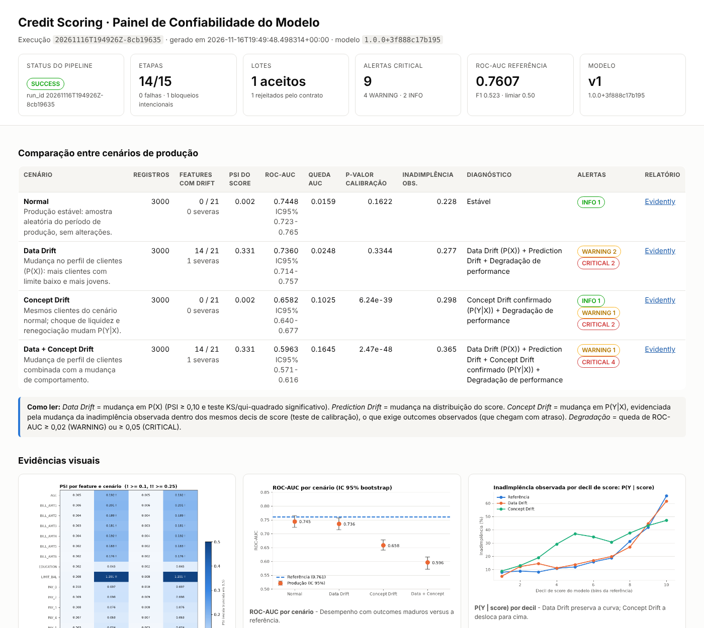 | 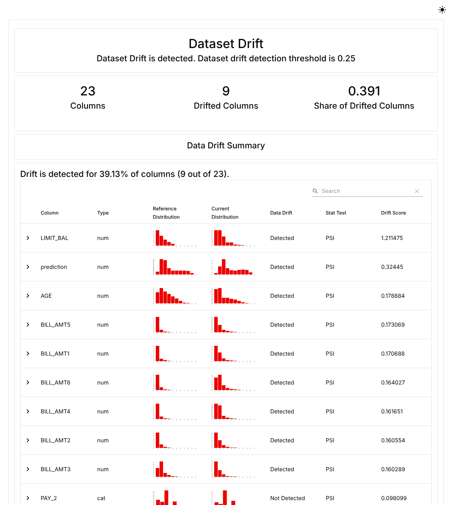 |

| MLflow — comparação dos 4 cenários | MLflow — lote inválido com status *Failed* |
|---|---|
| 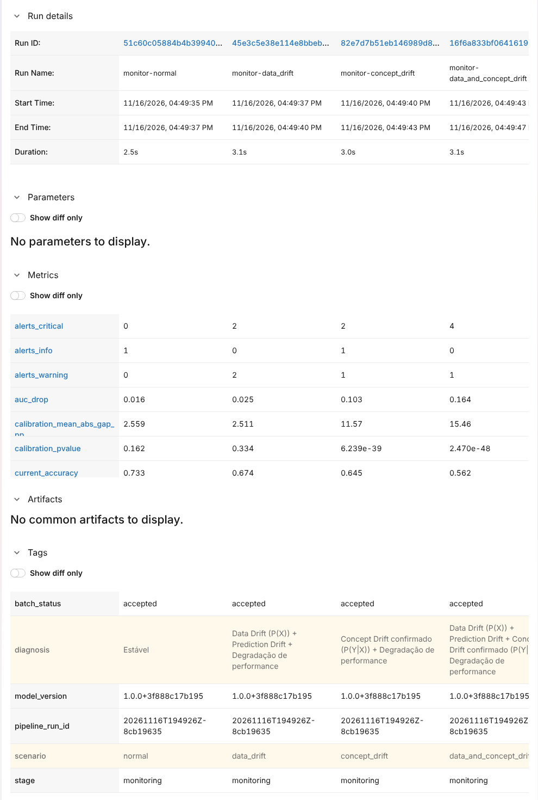 | 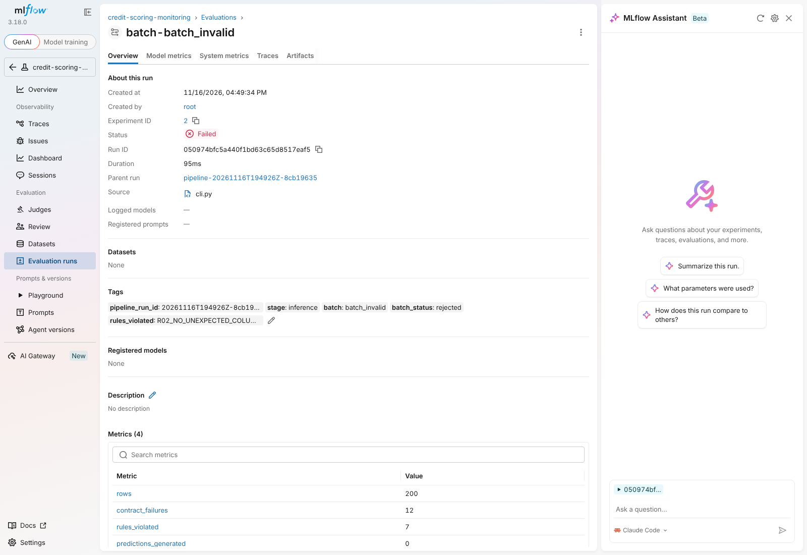 |

| PSI por feature e cenário | ROC-AUC por cenário |
|---|---|
| 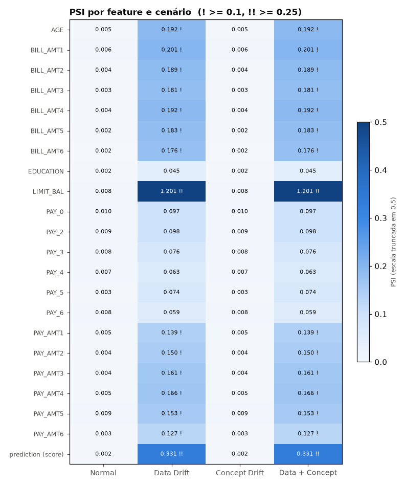 | 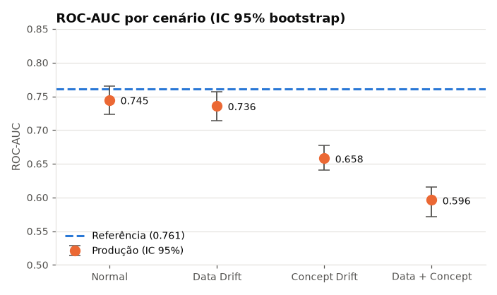 |

| Evidently — Concept Drift: 0 colunas com drift… | …mas a AUC cai de 0,761 para 0,658 |
|---|---|
| 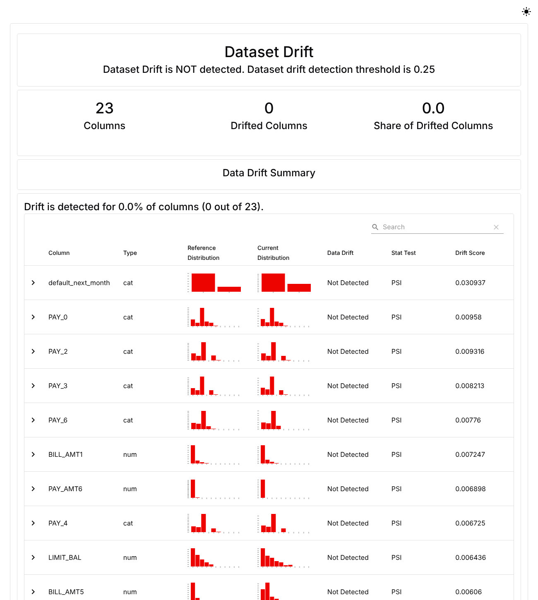 | 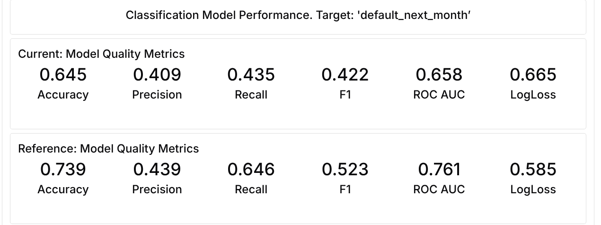 |

| P(Y \| score): Data Drift preserva, Concept Drift desloca | Lote inválido: violações por regra |
|---|---|
| 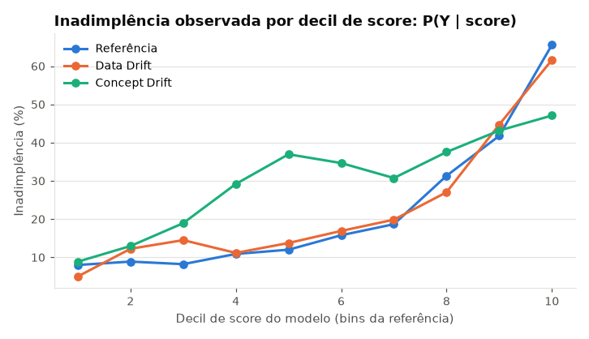 | 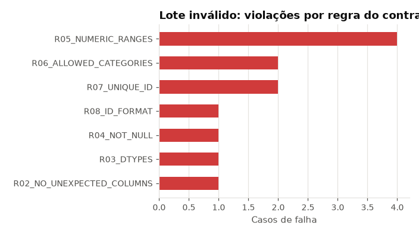 |

| LIMIT_BAL (data drift) | Distribuição do score (prediction drift) |
|---|---|
| 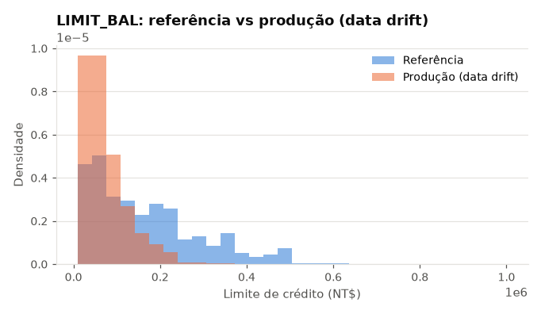 | 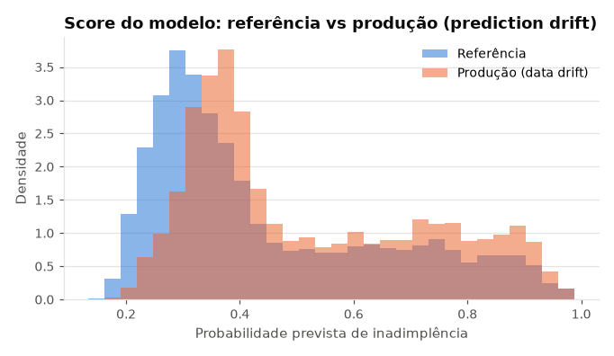 |

Outras evidências: [ROC](reports/figures/roc_reference.png) · [matriz de confusão](reports/figures/confusion_matrix_reference.png) · [coeficientes](reports/figures/model_coefficients.png) · [AGE](reports/figures/shift_age.png) · [alertas](reports/figures/alerts_by_scenario.png) · [aprovação por grupo](reports/figures/fairness_approval_rate.png) · [MLflow runs](reports/screenshots/mlflow_runs.png) · [EDA](reports/eda/).

## 11. Etapa 4 — Governança, privacidade e LGPD

> Este projeto é **acadêmico** e usa um dataset público já anonimizado na origem. As medidas abaixo separam **o que foi implementado** (✅) do que é **recomendado para uma fintech real** (📋). O projeto **não** afirma conformidade legal integral nem possui certificações. Não sou advogado: a aplicação concreta exige avaliação jurídica e do encarregado (DPO).

### 11.1 Finalidade e base legal

* **Finalidade (art. 6º, I, LGPD):** avaliar risco de inadimplência para conceder e gerenciar crédito, e monitorar a qualidade dessa avaliação. Qualquer uso secundário (marketing, por exemplo) exigiria nova análise de base legal.
* **Base legal aplicável à decisão de crédito (📋 fintech real):** **proteção do crédito (art. 7º, X)**, complementada por **execução de contrato e procedimentos preliminares (art. 7º, V)** e, para atividades acessórias como monitoramento antifraude, **legítimo interesse (art. 7º, IX)** com teste de balanceamento documentado. A base de proteção do crédito **não autoriza** o tratamento de dados pessoais sensíveis, que seguem o regime mais restrito do art. 11. A Lei do Cadastro Positivo (Lei 12.414/2011) também veda o uso de informações sensíveis (origem social e étnica, saúde, informação genética, orientação sexual, convicções políticas, religiosas e filosóficas) na análise de crédito.
* **No projeto (✅):** dados públicos, licenciados (CC BY 4.0) e anonimizados na origem, usados exclusivamente para fins acadêmicos e de pesquisa.

### 11.2 Identificação de dados pessoais

| Classe (LGPD) | Definição | Neste dataset | Tratamento |
|---|---|---|---|
| Dado pessoal (art. 5º, I) | Informação relacionada a pessoa natural identificada ou identificável | `ID`, `AGE`, `SEX`, `EDUCATION`, `MARRIAGE`, valores financeiros e histórico de pagamentos (em combinação, podem identificar indiretamente) | Pseudonimização, minimização, generalização na auditoria |
| Dado pessoal **sensível** (art. 5º, II) | Rol fechado: origem racial ou étnica, convicção religiosa, opinião política, filiação sindical ou a organização religiosa, filosófica ou política, saúde, vida sexual, dado genético ou biométrico | **Nenhum** campo do dataset pertence ao rol. `SEX` (sexo) não está no rol, mas é um **atributo protegido contra discriminação** e recebe tratamento reforçado | Fora do modelo e bloqueado na inferência |
| Dado anonimizado (art. 5º, III e XI) | Titular não identificável por meios técnicos razoáveis | O dataset público já é anonimizado na origem (sem nome, documento ou endereço) | — |

### 11.3 Medidas implementadas (✅) e recomendadas (📋)

| Princípio / tema | ✅ Implementado no projeto | 📋 Recomendado para fintech real |
|---|---|---|
| **Minimização** (art. 6º, III) | `SEX` e `MARRIAGE` excluídos do modelo. O contrato de inferência **rejeita** essas colunas e o target (R02) | Revisar periodicamente cada feature quanto à necessidade |
| **Pseudonimização** (art. 13, §4º) | `ID` substituído por HMAC-SHA256 com *salt* (`client_id`), e o contrato exige o formato pseudônimo (R08) | *Salt*/chave em cofre (KMS/Vault), rotação, separação de quem detém a chave |
| **Anonimização / generalização** | A auditoria de vieses usa faixas etárias e **suprime grupos com menos de 100 registros** | Avaliar risco de reidentificação antes de publicar qualquer agregado |
| **Privacy by Design** | Contratos que bloqueiam dados excessivos, outcomes separados das features, logs sem dados pessoais (só contagens, ids de execução e métricas) | RIPD (art. 38) antes de colocar o modelo em produção |
| **Privacy by Default** | Telemetria do MLflow desativada (`MLFLOW_DISABLE_TELEMETRY`, `DO_NOT_TRACK`), MLflow restrito a `127.0.0.1`, nenhum serviço externo | Configurações mais restritivas por padrão em todos os ambientes |
| **Controle de acesso** | Dados, modelo, MLflow e logs ficam **fora do Git** (`.gitignore`); só relatórios agregados são versionados | RBAC por papel (cientista, engenheiro, auditor), MFA e segregação de ambientes |
| **Proteção de artefatos e logs** | Quarentena separada, logs sem PII, modelo serializado com `skops` (tipos confiáveis declarados) | Criptografia em repouso e em trânsito, assinatura de artefatos, logs imutáveis |
| **Retenção e descarte** | Todos os dados derivados são regeneráveis por script; o descarte local é apagar `data/`, `mlflow.db`, `mlruns/`, `logs/` | Tabela de temporalidade (abaixo) e eliminação ao fim do tratamento (arts. 15 e 16) |
| **Rastreabilidade e auditoria** (art. 37) | `run_id` em todos os logs, alertas e runs. Manifestos com hash do dataset e do split. Versão do modelo vinculada ao hash do treino | Registro das operações de tratamento e trilha de auditoria centralizada |
| **Qualidade dos dados** (art. 6º, V) | 9 regras de contrato e 3 contratos distintos | Contratos também nas fontes upstream |
| **Não discriminação** (art. 6º, IX) | Auditoria de vieses por grupo (seção 12) | Monitoramento contínuo de equidade em produção |
| **Transparência e explicabilidade** | Modelo linear com coeficientes publicados | Motivos principais da decisão comunicados ao cliente |

**Plano de retenção (📋 proposta para fintech real, a validar com o jurídico):**

| Dado | Prazo sugerido | Fundamento / justificativa |
|---|---|---|
| Dados da proposta não aprovada | curto (ex.: 6 meses) e depois eliminação ou anonimização | necessidade (art. 6º, III) e término do tratamento (art. 15) |
| Dados do contrato ativo | duração do contrato + prazos legais e regulatórios aplicáveis | execução do contrato e obrigações legais (art. 16, I) |
| Histórico de adimplemento (cadastro positivo) | até 15 anos | Lei 12.414/2011 |
| Registros de incidentes de segurança | mínimo de 5 anos | Resolução CD/ANPD nº 15/2024 |
| Logs técnicos com `run_id` | 12 meses (sem PII) | rastreabilidade operacional |
| Dados de treino de modelos descontinuados | eliminação ou anonimização após o período de auditoria do modelo | minimização |

### 11.4 Direitos dos titulares e revisão de decisões automatizadas

* **Direitos (art. 18):** confirmação e acesso, correção, anonimização/bloqueio/eliminação de dados desnecessários, portabilidade, informação sobre compartilhamento e revogação do consentimento, quando essa for a base. 📋 Seria preciso um canal de atendimento e o registro do encarregado.
* **Revisão de decisões automatizadas (art. 20):** o titular pode pedir a revisão de decisões tomadas **unicamente** com base em tratamento automatizado, incluindo as que definem perfil de crédito, e tem direito a informações claras sobre os critérios usados, respeitados os segredos comercial e industrial.
  * ✅ O projeto usa um modelo interpretável, publica os coeficientes e registra versão do modelo e `run_id` de cada lote, o que permite reconstruir qual modelo e quais dados geraram a decisão.
  * 📋 Em produção: fila de revisão humana para recusas na zona cinzenta (scores próximos do limiar), explicação dos principais fatores da decisão e prazo de resposta definido.

### 11.5 Prevenção e resposta a incidentes

* ✅ Não há dados reais de clientes, segredos ou credenciais no repositório. O *salt* pode vir de uma variável de ambiente (`CREDIT_PSEUDO_SALT`), o CI só usa dados sintéticos e o MLflow escuta apenas em localhost.
* 📋 Fintech real: gestão de vulnerabilidades, princípio do menor privilégio, monitoramento de acesso a dados e um plano de resposta. Incidentes que possam acarretar risco ou dano relevante devem ser comunicados à **ANPD e aos titulares em até 3 dias úteis** (Resolução CD/ANPD nº 15/2024, art. 6º), com complementação em até 20 dias úteis e registro mantido por pelo menos 5 anos.

## 12. Mitigação de vieses

A auditoria ([`src/model/fairness.py`](src/model/fairness.py)) roda sobre o conjunto de referência (4.500 registros). Os atributos protegidos **não são usados pelo modelo**, apenas medidos. Grupos com menos de 100 registros são **suprimidos**: `MARRIAGE = outros` (60), `EDUCATION = outros` (72) e `AGE 60+` (49).

| Atributo | Grupo | n | Inadimplência real | Aprovação | Razão vs. melhor grupo | TPR | FPR | ROC-AUC |
|---|---|---:|---:|---:|---:|---:|---:|---:|
| SEX | feminino | 2.736 | 21,3% | 69,5% | 1,000 | 0,596 | 0,227 | 0,745 |
| SEX | masculino | 1.764 | 23,4% | 64,3% | 0,926 | 0,717 | 0,247 | 0,784 |
| EDUCATION | pós-graduação | 1.571 | 20,9% | 72,8% | 1,000 | 0,578 | 0,191 | 0,735 |
| EDUCATION | universitário | 2.094 | 22,7% | 64,9% | 0,891 | 0,666 | 0,259 | 0,764 |
| EDUCATION | ensino médio | 763 | 24,4% | 61,7% | **0,848** | 0,720 | 0,274 | 0,796 |
| AGE | até 29 | 1.496 | 22,1% | 65,0% | 0,922 | 0,671 | 0,259 | 0,776 |
| AGE | 30–44 | 2.235 | 21,5% | 70,5% | 1,000 | 0,618 | 0,207 | 0,752 |
| AGE | 45–59 | 720 | 23,3% | 63,1% | 0,895 | 0,691 | 0,272 | 0,766 |

Arquivos: [`reports/fairness/fairness_by_group.csv`](reports/fairness/fairness_by_group.csv) e [`fairness_findings.json`](reports/fairness/fairness_findings.json).

**Achados:**

* Todos os grupos ficam acima da heurística dos 4/5 para aprovação (menor razão: 0,848, ensino médio). Essa regra é apenas um **sinal**, não um critério legal brasileiro.
* Mesmo sem usar `SEX`, há diferença de **TPR** (0,596 vs. 0,717) e de aprovação entre os sexos. O modelo pode estar captando o atributo por variáveis correlacionadas (*proxies*), como limite e faturas. Em parte, a diferença reflete a taxa base distinta (21,3% vs. 23,4%).
* `EDUCATION` está no modelo e tem a maior dispersão de AUC (0,061). Por ser socioeconômica, merece revisão de necessidade (minimização) e teste de impacto ao ser removida.

**Mitigações:** remoção de atributos protegidos (✅), supressão de grupos pequenos (✅) e auditoria reproduzível a cada treino (✅). 📋 Recomendado: avaliar a remoção de `EDUCATION`, testar *proxies* (correlação de cada feature com atributos protegidos), definir limites aceitáveis de disparidade (por exemplo, diferença de TPR), fazer pós-processamento por limiar apenas com respaldo jurídico, usar monitoramento de equidade como métrica do MLflow e manter um comitê de risco de modelo.

**Limitações:** dados de 2005 de Taiwan não representam a população brasileira atual. Não há atributos de raça ou região, de modo que vieses nessas dimensões não podem ser medidos com este dataset.

## 13. Análise causal

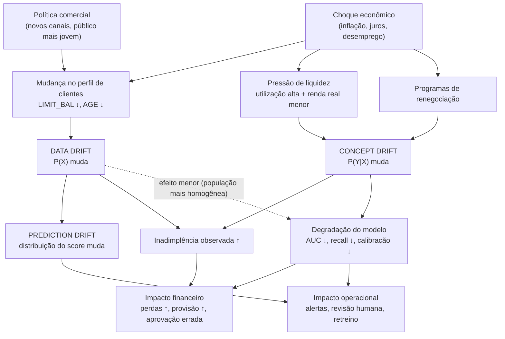

| Elo causal | Status | Evidência |
|---|---|---|
| Mudança de perfil → Data Drift → mais inadimplência | **Demonstrado pela simulação** | Mesmo P(Y\|X): inadimplência 22,8% → 27,7% só pela mudança do mix |
| Mudança de comportamento → Concept Drift → degradação | **Demonstrado pela simulação** | Mesmas linhas X: AUC 0,7448 → 0,6582 e recall 0,608 → 0,435 |
| Data Drift preserva P(Y \| score) | **Demonstrado nos dados reais deste modelo** | p = 0,334 na calibração |
| Data + Concept se somam | **Demonstrado** | AUC 0,5963, inadimplência 36,5% |
| Inflação/juros causam o aumento de utilização e inadimplência | **Hipótese** (mundo real) | Exige séries macroeconômicas e desenho quasi-experimental |
| Programas de renegociação "curam" atrasados | **Hipótese** | Exige dados de adesão e acompanhamento |
| Impacto financeiro em R$ | **Hipótese** | Exige LGD, EAD e custo de oportunidade da carteira |

**Interpretação:** a simulação demonstra causalidade **por construção**: eu controlo o mecanismo e altero uma única coisa por cenário. Isso valida que o sistema de monitoramento **separa corretamente** as causas. Não demonstra que, no mundo real, a inflação produza exatamente esses efeitos. Validar isso exigiria dados temporais reais, variáveis macroeconômicas, outcomes maduros e métodos como diferenças-em-diferenças ou variáveis instrumentais.

**Cautela adicional:** o teste de calibração mede P(Y | score) e é **evidência**, não prova, de Concept Drift. Com um modelo mal especificado, uma mudança forte em P(X) pode alterar P(Y | score) mesmo sem mudança em P(Y|X). Vi esse efeito nos dados sintéticos dos testes. Por isso a confirmação exige investigação humana (seção 14).

**Impacto em ordem de grandeza (simulação):** no `concept_drift`, com o mesmo limiar, o modelo deixou de identificar **56,5%** dos inadimplentes (recall 0,435) contra 35,4% na referência (recall 0,646). Cada falso negativo é um crédito concedido que não volta.

## 14. Plano de resposta à degradação

| Situação | Gatilho (regra) | Ação imediata | Investigação | Decisão |
|---|---|---|---|---|
| **Violação de contrato** | `DATA_CONTRACT_VIOLATION` (CRITICAL) | Lote bloqueado e em quarentena, sem decisão automática; acionar o dono da fonte | Ler `*_failure_cases.csv` e identificar a origem (deploy upstream, mudança de layout) | Corrigir e reprocessar; nunca "afrouxar" o contrato sem análise |
| **Data Drift moderado** | `DATA_DRIFT_MODERATE` (WARNING) | Manter o modelo; aumentar a frequência de monitoramento | Segmentar o drift (canal, produto, região); checar mudanças comerciais | Acompanhar e preparar dados para eventual retreino |
| **Data Drift severo** | `DATA_DRIFT_SEVERE` (CRITICAL) | Comunicar risco e crédito; **revisão humana** para segmentos fora da referência | Verificar se a região do espaço X tem cobertura no treino; comparar a calibração | Política de crédito conservadora temporária (limiar maior ou limites menores) e avaliação de retreino |
| **Degradação de performance** | `PERFORMANCE_DEGRADATION` | Confirmar com o IC (não reagir a ruído); verificar maturidade dos outcomes | Separar degradação por mix (Data Drift) de mudança de relação (calibração) | Recalibrar ou retreinar conforme a causa |
| **Suspeita de Concept Drift** | `CONCEPT_DRIFT_SUSPECTED` | Abrir incidente de risco de modelo; ampliar a amostra de outcomes | Análise por decil e segmento; confirmar com nova safra | Limiar provisório mais conservador |
| **Concept Drift confirmado** | `CONCEPT_DRIFT_CONFIRMED` (CRITICAL) | Comitê de risco de modelo; revisão humana nas zonas cinzentas | Identificar a causa (macroeconômica, regulatória, fraude) | **Retreinar** com dados recentes e rotulados, validar e implantar com segurança |

**Ciclo de retreino e implantação segura:**

1. Montar o dataset com a nova safra (outcomes maduros), passando pelo mesmo contrato `training`.
2. Treinar o candidato (nova versão no Model Registry) e comparar com o campeão na mesma janela recente (AUC, calibração, equidade).
3. Aprovar com o comitê se o candidato for melhor sem piorar a equidade. Documentar a decisão (versão, métricas, `run_id`).
4. Implantar com rollout gradual (*shadow* e depois canário), acompanhando as mesmas métricas de alerta.
5. **Rollback:** manter a versão anterior no registry e voltar a ela (troca de versão ou alias) se surgirem alertas CRITICAL na nova versão ou queda de AUC ≥ 0,05.

## 15. Instalação e execução

Pré-requisitos: **Python 3.12**, Git e VS Code.

```powershell
# Windows / PowerShell (na raiz do repositório)
py -3.12 -m venv .venv
.\.venv\Scripts\Activate.ps1
python -m pip install --upgrade pip
pip install -r requirements.txt

python -m src.cli run-all                 # pipeline completo (~35 s)
start reports\monitoring_dashboard.html   # dashboard
mlflow ui --backend-store-uri sqlite:///mlflow.db --port 5000   # http://127.0.0.1:5000
```

Comandos individuais:

| Comando | O que faz |
|---|---|
| `python -m src.cli download-data` | Baixa e verifica o dataset (hash SHA-256) |
| `python -m src.cli prepare-data` | Limpa, pseudonimiza, separa e gera os lotes de demonstração |
| `python -m src.cli validate --input <csv> --mode training\|inference\|outcome` | Valida um arquivo contra um contrato (exit code 2 se inválido) |
| `python -m src.cli train` | Treina, avalia, persiste e registra o modelo |
| `python -m src.cli predict --input <csv>` | Inferência com gate (exit code 2 e zero predições se inválido) |
| `python -m src.cli simulate-drift` | Gera os 4 cenários |
| `python -m src.cli monitor [--scenario ...]` | Monitora os cenários, gera Evidently, alertas e dashboard |
| `python -m src.cli run-all [--skip-download] [--skip-train]` | Tudo de ponta a ponta |

## 16. Testes e qualidade

```powershell
ruff check .
ruff format --check .
python -m pytest --cov --cov-report=term-missing
```

| Verificação | Resultado real |
|---|---|
| Testes | **109 aprovados** (unitários, integração, ponta a ponta) em ~2 min 17 s |
| Cobertura de `src/` | **97,77%** (mínimo configurado: 85%) |
| Ruff (lint + formatação) | sem apontamentos |
| Clone limpo em caminho com espaço (`/tmp/val fase 4/...`) | instalação, `run-all`, testes e lint aprovados |

A suíte usa um **dataset sintético** com o mesmo esquema e não faz downloads. Ela cobre carregamento, preparação, split, ausência de vazamento, cada regra de contrato, aceitação e rejeição de lotes, bloqueio da inferência, treino, persistência, predições, reprodutibilidade, simulações de Data e Concept Drift, identificação de features com drift, cenário sem drift, alertas, logs, métricas no MLflow (runs FINISHED e FAILED), relatórios HTML e o pipeline completo via CLI. O CI ([`.github/workflows/ci.yml`](.github/workflows/ci.yml)) executa as mesmas verificações a cada push e pull request. Detalhes: [docs/VALIDACAO_FINAL.md](docs/VALIDACAO_FINAL.md).

## 17. Limitações

* **Tempo simulado:** o dataset não tem eixo temporal, então a passagem do tempo e os choques econômicos são simulados com mecanismos explícitos.
* **Outcomes imediatos na simulação:** em produção, os rótulos chegam meses depois. O projeto separa features e outcomes para representar isso, mas não modela o atraso real nem o viés de seleção (só se observa o outcome de quem foi aprovado — *reject inference*).
* **Infraestrutura:** não há API de inferência, orquestrador (Airflow/Prefect), alertas por e-mail/Slack nem monitoramento de servidores. Os alertas são registrados em log, JSON, MLflow e no dashboard.
* **MLflow local:** backend SQLite em arquivo, adequado para estudo, não para uso multiusuário.
* **Modelo simples por escolha:** o foco é a camada de confiabilidade, não a performance máxima.
* **Fonte oficial:** no ambiente de desenvolvimento a URL da UCI estava bloqueada pelo proxy. O download usou um espelho verificado pelo hash. Em uma máquina comum, a fonte oficial é tentada primeiro.
* **Validação no Windows:** o projeto foi desenvolvido e validado em Linux (Python 3.12). Os comandos PowerShell foram preparados para Windows, mas a execução nativa no Windows ainda deve ser confirmada com os comandos da seção 15.

## 18. Referências

* Yeh, I. C.; Lien, C. H. (2009). *The comparisons of data mining techniques for the predictive accuracy of probability of default of credit card clients.* Expert Systems with Applications, 36(2), 2473–2480. Dataset: <https://doi.org/10.24432/C55S3H>
* Brasil. **Lei nº 13.709/2018 (LGPD)**: <https://www.planalto.gov.br/ccivil_03/_ato2015-2018/2018/lei/l13709.htm>
* Brasil. **Lei nº 12.414/2011 (Cadastro Positivo)**: <https://www.planalto.gov.br/ccivil_03/_ato2011-2014/2011/lei/l12414.htm>
* ANPD. **Resolução CD/ANPD nº 15/2024**, Regulamento de Comunicação de Incidente de Segurança: <https://www.in.gov.br/en/web/dou/-/resolucao-cd/anpd-n-15-de-24-de-abril-de-2024-556243024>
* ANPD — Autoridade Nacional de Proteção de Dados: <https://www.gov.br/anpd>
* Evidently AI — documentação: <https://docs.evidentlyai.com>
* Pandera — documentação: <https://pandera.readthedocs.io>
* MLflow — documentação: <https://mlflow.org/docs/latest>
* Siddiqi, N. (2017). *Intelligent Credit Scoring* (2ª ed.). Wiley. (Referência de uso do PSI e dos limiares 0,10/0,25.)
* Gama, J. et al. (2014). *A survey on concept drift adaptation.* ACM Computing Surveys, 46(4).
