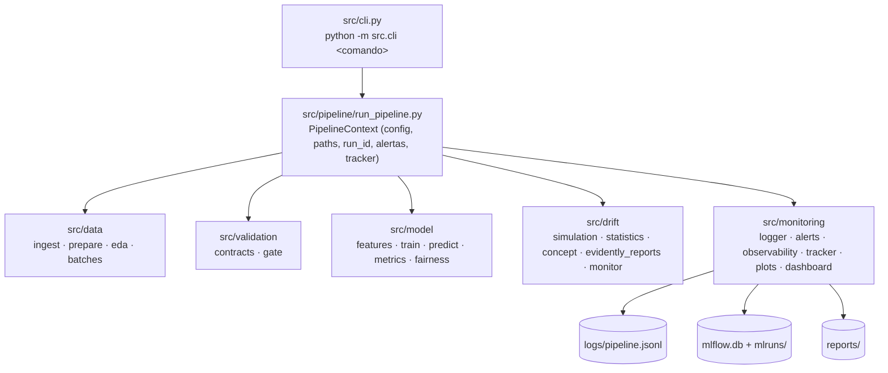
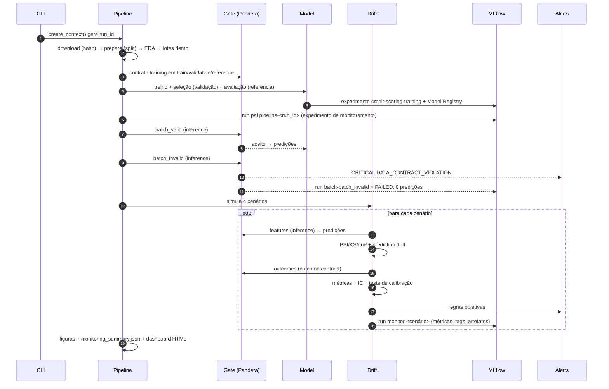

# Arquitetura e fluxo técnico

Este documento detalha **como** a solução funciona. O **porquê** de negócio e os resultados estão no [README](../README.md).

## Visão em camadas



## Sequência do `run-all`



## Responsabilidades por módulo

| Arquivo | Responsabilidade |
|---|---|
| `src/config.py` | Lê `configs/config.yaml`, resolve caminhos (Windows/Linux) e define a ordem das features do modelo |
| `src/data/ingest.py` | Baixa a fonte oficial ou um espelho, normaliza o esquema, valida linhas, colunas e hash SHA-256 e grava o manifesto com licença e citação |
| `src/data/prepare.py` | Recodifica códigos não documentados, pseudonimiza o `ID` (HMAC-SHA256), faz o split estratificado em 4 partições e verifica vazamento |
| `src/data/eda.py` | EDA objetiva **apenas no treino** (JSON + figuras) |
| `src/data/batches.py` | Lote válido e lote inválido com violações documentadas (`INJECTED_VIOLATIONS`) |
| `src/validation/contracts.py` | Schemas Pandera (`training`, `inference`, `outcome`), regras R01–R09, mapeamento de falhas para regras |
| `src/validation/gate.py` | `validate_batch` (função pura) e `enforce_contract` (relatório, quarentena, log, alerta e exceção) |
| `src/model/features.py` | Transformador sklearn com features de utilização e atraso e log com sinal |
| `src/model/train.py` | Pipeline sklearn, seleção de `C`, limiar por F1, avaliação, persistência (joblib), MLflow e Model Registry |
| `src/model/predict.py` | Carrega o modelo e faz inferência **sempre após** o contrato `inference`, medindo latência |
| `src/model/metrics.py` | Métricas de classificação, IC bootstrap da AUC, limiar ótimo |
| `src/model/fairness.py` | Métricas por grupo protegido, supressão de grupos pequenos, heurística dos 4/5 |
| `src/drift/simulation.py` | Cenários `normal`, `data_drift`, `concept_drift`, `data_and_concept_drift` (seeds fixas) |
| `src/drift/statistics.py` | PSI (quantis/categorias), KS, qui-quadrado, tabela de drift por feature, prediction drift |
| `src/drift/concept.py` | Teste de calibração P(Y \| score), deltas de performance, diagnóstico que separa os tipos de drift |
| `src/drift/evidently_reports.py` | Relatório Evidently (DataDrift + Classification) e extração de resumo |
| `src/drift/monitor.py` | Ciclo completo de monitoramento por cenário (gate → drift → outcomes → alertas → Evidently → MLflow) |
| `src/monitoring/logger.py` | Logs JSON Lines com `run_id` (contextvars) e console legível |
| `src/monitoring/alerts.py` | Modelo de alerta, severidades e regras objetivas |
| `src/monitoring/observability.py` | Rastreio de etapas (status, início/fim, duração, volumes, RSS/CPU) |
| `src/monitoring/tracker.py` | MLflow local (SQLite), experimentos com raiz de artefatos no projeto |
| `src/monitoring/plots.py` | Figuras PNG com paleta consistente e acessível |
| `src/monitoring/dashboard.py` | Dashboard HTML autocontido (imagens embutidas, funciona offline) |
| `src/pipeline/run_pipeline.py` | Orquestração, runs MLflow pai/filhos, resumo consolidado |
| `src/cli.py` | Comandos e *exit codes*: 0 OK, 1 erro, 2 violação de contrato |

## Decisões de projeto (e por quê)

| Decisão | Alternativa considerada | Justificativa |
|---|---|---|
| Regressão logística | XGBoost | Interpretabilidade (LGPD art. 20) e o foco do desafio é a camada de confiabilidade |
| Pandera | Great Expectations | API em Python puro, testável com pytest, menos configuração e dependências |
| Data Drift por **amostragem ponderada** de registros reais | Multiplicar colunas por fatores | Preserva P(Y\|X) por construção e isola P(X); multiplicar valores misturaria Data e Concept Drift |
| Concept Drift por **mecanismo explícito sobre as mesmas linhas** | Embaralhar rótulos | Mudança economicamente interpretável e P(X) idêntico (prova controlada) |
| PSI por **quantis da referência** + teste estatístico | Só p-valor (KS) | Com milhares de linhas o p-valor é sempre "significativo"; o PSI mede materialidade e o teste mede significância |
| Teste de calibração por decil | Só queda de AUC | A queda de AUC também ocorre com Data Drift puro; a calibração isola P(Y\|score) |
| MLflow com SQLite | Arquivos `mlruns` | O MLflow 3.x recomenda backend de banco; o SQLite não precisa de servidor |
| Tag `mlflow.experimentKind = custom_model_development` | Padrão GenAI do MLflow 3 | Abre a interface na visão de runs de treinamento (tabela e comparação) |
| `skops` com tipos confiáveis | pickle sem verificação | O MLflow 3.18 serializa com skops e exige declarar a classe customizada |
| pandas 2.3.3 | pandas 3.x | Evidently 0.7.23 quebra com pandas 3 (incompatibilidade reproduzida) |
| Dashboard em HTML autocontido | Streamlit/Grafana | Zero infraestrutura, abre em qualquer navegador e é versionável |

## Contratos de entrada e saída de dados

```text
data/raw/default_of_credit_card_clients.csv     ← download (30.000 x 25, inteiros)
data/reference/{train,validation,reference}.csv ← prepare (com SEX, MARRIAGE, target)
data/reference/reference_scored.csv             ← train (referência + prediction + predicted_label)
data/production/production_pool.csv            ← prepare (7.500 registros, nunca usados no treino)
data/production/batch_valid.csv                 ← prepare (500, somente features)
data/invalid/batch_invalid.csv                  ← prepare (200, com violações)
data/production/scenarios/<cenário>_features.csv / _outcomes.csv / scenario_manifest.json
data/production/predictions/<lote>_predictions.csv
data/invalid/quarantine/<lote>__<run_id>.csv
```

## Identificador de execução (`run_id`)

Formato `AAAAMMDDTHHMMSSZ-xxxxxxxx` (UTC + 8 hex aleatórios). Ele está presente em:

* cada linha de `logs/pipeline.jsonl` (campo `run_id`);
* cada alerta (`reports/alerts.json`);
* tag `pipeline_run_id` de todos os runs MLflow;
* `reports/monitoring_summary.json`, `reports/drift/*_summary.json`, `reports/validation/*.json`;
* nome do arquivo em quarentena.

Com o `run_id`, um engenheiro sai de um alerta no dashboard para o run no MLflow e para as linhas de log daquela execução.
